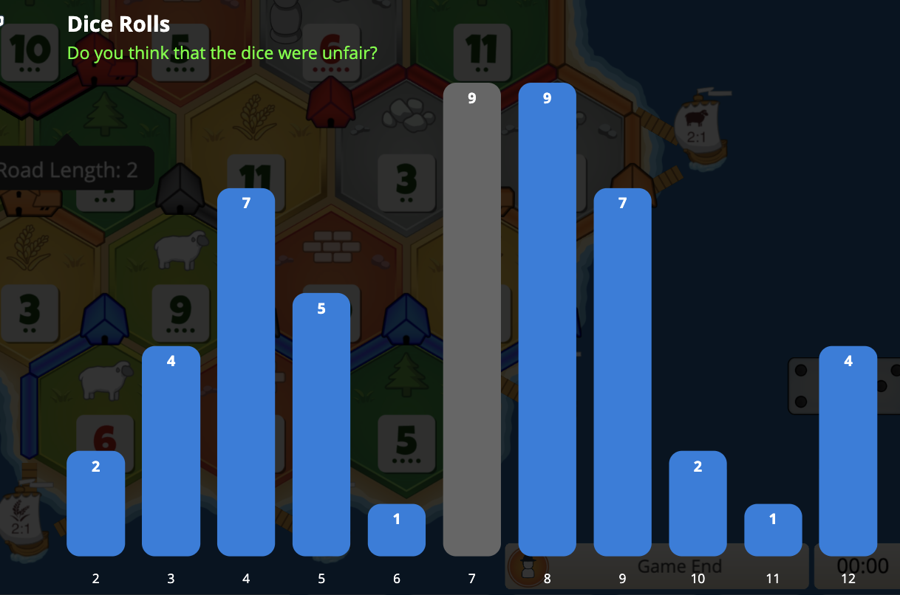

+++
title = "Exploiting the law of small numbers in Catan"

[extra]
math = true
+++

160,000 games of Settlers of Catan are played daily on [colonist.io](https://colonist.io).[^summary] Players often complain the dice are rigged because the end-of-game roll histogram doesn't form a perfect bell curve. With games only lasting 50-80 turns, these outcomes are expected. Tversky and Kahneman identified this cognitive bias as "belief in the law of small numbers": people expect small samples to mirror the population distribution, and treat normal variance as evidence of a broken system.



> Is dice "Balanced" in ranked? what is this sh** - Colonist.io Discord message

Despite the dice being fair, Colonist responded by replacing them with "balanced dice."[^balanced] Instead of rolling independently, the algorithm draws from a 36-card deck and penalizes recently rolled numbers, smoothing out short-run variance. The algorithm made the game feel fairer, but in doing so made the dice more predictable. A player who understands the algorithm can factor it into robber and hand management decisions to gain a real edge over opponents who assume fair dice.

## The algorithm

The balanced dice algorithm replaces two independent dice with a weighted deck. The deck contains 36 cards, one for each possible (die1, die2) outcome. The algorithm draws cards without replacement and reshuffles when 13 cards remain, giving 23 draws per cycle.[^source]

Before each draw, the algorithm computes a weight for each sum $k \in \lbrace 2, 3, \ldots, 12\rbrace$ through three stages.

**Stage 1: Base weights.** Let $c_k$ denote the number of cards remaining in the deck with sum $k$, and let $N$ denote the total cards remaining. The base weight for sum $k$ equals

$$w_k = \frac{c_k}{N}$$

This alone would produce a uniform draw over remaining cards, equivalent to dealing from a physical deck.

**Stage 2: Recency penalty.** The algorithm tracks a sliding window of the last 5 rolls. Let $a_k$ denote the number of times sum $k$ appeared in this window. The algorithm multiplies the weight by a penalty factor:

$$w_k \leftarrow w_k \cdot \max(0,\thickspace 1 - 0.34 \cdot a_k)$$

At $a_k = 3$, the weight drops to zero. No sum can appear more than 3 times in any 5-roll window.

**Stage 3: Seven balancing (1v1 only).** The algorithm applies an additional multiplier to $k = 7$, clamped to $[0, 2]$ and computed from two components.[^sevens]

A streak component penalizes consecutive 7s by the rolling player and boosts the opponent:

$$s = \pm\thinspace 0.4 \cdot n_{\text{streak}}$$

Negative when you rolled the streak, positive when your opponent did.

An imbalance component pulls each player's share of total 7s toward 50%:

$$b = 1 + \frac{0.5 - p_7}{0.5}$$

This activates once both players have rolled at least one 7. The final seven multiplier combines both:

$$w_7 \leftarrow w_7 \cdot \text{clamp}(b + s,\thickspace 0,\thickspace 2)$$

**Stage 4: Normalize and draw.** The algorithm normalizes all weights to a probability distribution and draws one card.

<link rel="stylesheet" href="./dice-sim.css">
<div id="dice-sim" class="dice-sim"><noscript>This interactive simulator needs JavaScript.</noscript></div>
<script src="./dice-sim.js" defer></script>

## Rules of thumb

These rules follow directly from the algorithm and require nothing beyond what you can hold in your head during a game.

**Recency window.** The 5-roll sliding window creates hard constraints on short-run repetition.

- A number that rolled last turn has its weight multiplied by $1 - 0.34 = 0.66$, so it becomes 34% less likely than baseline.
- A number that rolled twice in the last 5 turns has its weight multiplied by $1 - 0.68 = 0.32$, so it becomes 68% less likely.
- A number that rolled three times in the last 5 turns has weight zero. This acts as a hard cap: no number can appear more than 3 times in any 5-roll window.

**Deck cycles.** The deck reshuffles every 23 rolls (36 cards minus 13 remaining). Within a single cycle, drawn cards cannot appear again.

- After a 2 or 12 rolls, that number cannot roll again until the next reshuffle, because only 1 card in the deck produces each.
- The same applies to 3 and 11 after the algorithm draws both their cards (2 cards each), and to 4 and 10 after all 3.
- Despite this, 2 and 12 still fail to appear in roughly 27% of cycles. The lone 2-card or 12-card sits in the undrawn remainder about one in four times.

**Seven balancing (1v1).** The imbalance component $b$ dominates seven weighting over the course of a game.

- If you have rolled 100% of the 7s so far, $p_7 = 1$ and $b = 1 + \frac{0.5 - 1}{0.5} = 0$. Your 7-weight drops to zero.
- At 75% share, $p_7 = 0.75$ and $b = 0.5$, cutting your 7-weight in half.
- If your opponent holds a streak of 2+ consecutive 7s, the streak component pushes your multiplier toward the cap of $2 \times$ base weight.
- Over a full game, each player's share of 7s converges toward 50%.

## How good of a predictor can you be?

The rules above give qualitative intuition. We can also measure how much predictive advantage the algorithm hands to an informed player.

Frame this as a forecasting problem. Before each roll, two models produce probability distributions over sums $\lbrace 2, 3, \ldots, 12\rbrace$. The naive model assigns standard 2d6 probabilities:

$$P_{\text{naive}}(k) = \frac{6 - |k - 7|}{36}$$

The informed model tracks deck state and the recency window, computing weights exactly as the algorithm does.

We compare them using log score. If a model assigns probability $p$ to the outcome that actually occurs, it scores $\log_2 p$. A model that concentrates probability on correct outcomes scores higher (closer to 0). A model that spreads probability uniformly scores lower (more negative).

The expected difference in log scores between two models relates to KL divergence:

$$D_{\text{KL}}(Q \Vert P) = \sum_{k=2}^{12} Q(k) \log_2 \frac{Q(k)}{P(k)}$$

This measures the bits of predictive information per roll that the informed model captures and the naive model misses. Right after a reshuffle, the two models nearly agree and $D_{\text{KL}} \approx 0$. Late in a deck cycle, the informed model knows which sums remain possible and concentrates its probability mass on them.

We can simulate this using the `BalancedDice` implementation from [`code.py`](code.py), with [`sim.py`](sim.py):

```
naive:    -3.3041 bits/roll
informed: -3.0433 bits/roll
edge:      0.2608 bits/roll
```

The informed model scores 0.26 bits better per roll. Since $2^{0.26} \approx 1.20$, the informed model assigns roughly 20% higher probability to the outcome that actually occurs on average. When the naive model says "6 has a 13.9% chance," the informed model might say "16.7%" and be right more often.

Over a 70-roll game, that compounds: $70 \times 0.26 = 18.2$ total bits of advantage. A Kelly bettor using the informed model would grow their bankroll $2^{18.2} \approx 300{,}000$ times faster than one using naive probabilities. Nobody bets on Catan rolls, but every decision about where to build, when to move the robber, or which trades to accept implicitly bets on future roll distributions. A player with a 20% better forecast per roll makes systematically better bets across the whole game. Belief in the law of small numbers drove the complaints that led to balanced dice, and balanced dice gave informed players a quantifiable edge.

## References

[^summary]: Colonist.io 2025 summary, <https://blog.colonist.io/colonist-io-2025-summary/>

[^balanced]: Designing balanced dice, Colonist.io blog, <https://blog.colonist.io/designing-balanced-dice/>

[^source]: Reverse-engineered balanced-dice source, <https://pastebin.com/wWH4Ka96>

[^sevens]: Balancing 7s in 1v1, Colonist.io blog, <https://blog.colonist.io/balancing-7s-on-1v1/>
